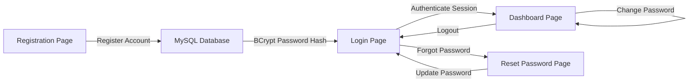

# Modern User Registration & Authentication System

A modern, responsive, full-stack **User Registration, Login, and Account Dashboard** web application. Built with **Java 17, Spring Boot 3, Spring Security 6, MySQL 8, and modern Vanilla HTML5/CSS3/JavaScript**.

---

## 📸 Overview & Features

### 1. 📝 Registration (Sign Up)
- **Form Fields:** Full Name, Username, Email Address, Mobile Number (optional), Password, and Confirm Password.
- **Client & Server-side Validation:** Checks required fields, email format, minimum 8 characters password, and username character set.
- **Duplicate Prevention:** Prevents duplicate email and username registrations with clear, helpful feedback.
- **Real-Time Password Strength Meter:** Visual colored bars and labels (*Weak*, *Fair*, *Good*, *Strong*).
- **Show/Hide Password:** Interactive eye toggle icons for both password fields.
- **BCrypt Security:** Passwords hashed with BCrypt (strength/cost factor 12) before being stored in MySQL.
- **Smooth Redirect:** On success, redirects to the Login page with a success message and pre-filled email.

### 2. 🔐 Login (Sign In)
- **Form Fields:** Email or Username, Password, Remember Me checkbox, and Forgot Password link.
- **Authentication:** Authenticates credentials against Spring Security's `AuthenticationManager` and MySQL database.
- **Session Security:** Uses secure, HTTP-only `JSESSIONID` cookies; never transmits or stores plaintext passwords.
- **Error Handling:** Clear toast notifications and alert boxes for incorrect credentials.
- **Remember Me:** Saves email in localStorage and extends session inactivity timeout.
- **Route Redirection:** Automatically forwards authenticated users to the Dashboard.

### 3. 👤 User Dashboard
- **Route Guard:** Protected frontend and backend routes. If unauthenticated, immediately redirects to `/login.html`.
- **Personalized Header:** Dynamic greeting based on time of day (Good morning / afternoon / evening) with user's full name.
- **Profile Info Cards:** Full Name, `@username`, registered Email, Mobile number, MySQL Record ID, and Member Since timestamp.
- **Account Status:** Live session active beacon indicator.
- **Password Management:** "Change Password" tab with current password verification, new password strength meter, and confirmation check.
- **Logout:** Invalidation of Spring Security session and HTTP session cookies, redirecting back to login.

### 4. 🔑 Forgot & Reset Password
- **Forgot Password Modal:** Enter registered email to generate a time-limited (15-minute), single-use reset token.
- **Token Validation:** Secure validation endpoint ensures tokens cannot be reused or used after expiry.
- **Dedicated Reset Page:** Clean `reset-password.html?token=...` UI to set a new password.

---

## 🛠️ Technology Stack

| Layer | Technology | Details |
|---|---|---|
| **Backend** | Java 17, Spring Boot 3.2.3 | Spring Web, Spring Data JPA, Hibernate, Bean Validation |
| **Security** | Spring Security 6.2 | BCrypt password hashing (factor 12), HTTP-only cookies, Session management |
| **Database** | MySQL 8.0+ | InnoDB, UTF-8 (utf8mb4), indexed unique constraints |
| **Frontend** | HTML5, CSS3, Vanilla JS | Modern glassmorphism, responsive CSS grid/flexbox, SVG icons, toast notifications |
| **Build Tool** | Apache Maven 3.9+ | Standard Maven directory layout with Maven Wrapper |

---

## 📁 Project Structure

```
login_Page/
├── pom.xml                                   # Maven build configuration & dependencies
├── schema.sql                                # MySQL database schema & DDL statements
├── .env.example                              # Environment variable configuration template
├── mvnw.cmd                                  # Maven wrapper for Windows
├── README.md                                 # Full documentation & setup guide
└── src/
    └── main/
        ├── java/com/auth/userauth/
        │   ├── UserAuthApplication.java      # Application main entry point
        │   ├── config/
        │   │   ├── SecurityConfig.java       # Spring Security & BCrypt configuration
        │   │   └── WebConfig.java            # MVC view controller & CORS mappings
        │   ├── controller/
        │   │   ├── AuthController.java       # Register, Login, Logout, Reset APIs
        │   │   └── UserController.java       # Profile & Change Password APIs
        │   ├── dto/
        │   │   ├── ApiResponse.java          # Standard JSON API response envelope
        │   │   ├── RegisterRequest.java      # Sign up validation DTO
        │   │   ├── LoginRequest.java         # Sign in DTO
        │   │   ├── ForgotPasswordRequest.java# Forgot password DTO
        │   │   ├── ResetPasswordRequest.java # Reset password DTO
        │   │   ├── ChangePasswordRequest.java# Change password DTO
        │   │   └── UserDto.java              # Safe public user profile (no password)
        │   ├── entity/
        │   │   ├── User.java                 # JPA Entity for `users` table
        │   │   └── PasswordResetToken.java   # JPA Entity for reset tokens
        │   ├── exception/
        │   │   ├── BadRequestException.java
        │   │   ├── ResourceNotFoundException.java
        │   │   └── GlobalExceptionHandler.java# Central REST error handler
        │   ├── repository/
        │   │   ├── UserRepository.java       # Spring Data JPA UserRepository
        │   │   └── PasswordResetTokenRepository.java
        │   ├── security/
        │   │   ├── CustomUserDetailsService.java
        │   │   └── UserPrincipal.java        # Spring Security UserDetails implementation
        │   └── service/
        │       ├── AuthService.java          # Core authentication business logic
        │       └── UserService.java          # User profile operations
        └── resources/
            ├── application.properties        # Database & application properties
            └── static/                       # Modern Frontend UI Assets
                ├── index.html                # Entry point
                ├── login.html                # Sign In page + Forgot Password modal
                ├── register.html             # Sign Up page with strength meter
                ├── dashboard.html            # User Dashboard & Profile
                ├── reset-password.html       # Token-based password reset page
                ├── css/
                │   ├── styles.css            # Design system, forms, toasts, cards
                │   └── dashboard.css         # Dashboard layout, tabs, banners
                └── js/
                    ├── auth.js               # Toast system, password toggles, API fetch
                    ├── register.js           # Registration validation & submission
                    ├── login.js              # Login authentication & modal handler
                    ├── dashboard.js          # Route guard, profile rendering, change pwd
                    └── reset-password.js     # Reset password form & token validation
```

---

## 🗄️ Database Configuration & Schema

### 1. Database Schema (`schema.sql`)
```sql
CREATE DATABASE IF NOT EXISTS user_auth_db CHARACTER SET utf8mb4 COLLATE utf8mb4_unicode_ci;
USE user_auth_db;

-- 1. Users Table
CREATE TABLE IF NOT EXISTS users (
    id BIGINT AUTO_INCREMENT PRIMARY KEY,
    full_name VARCHAR(100) NOT NULL,
    username VARCHAR(50) NOT NULL UNIQUE,
    email VARCHAR(100) NOT NULL UNIQUE,
    mobile_number VARCHAR(20) DEFAULT NULL,
    password_hash VARCHAR(255) NOT NULL,
    created_at TIMESTAMP DEFAULT CURRENT_TIMESTAMP,
    INDEX idx_user_email (email),
    INDEX idx_user_username (username)
) ENGINE=InnoDB DEFAULT CHARSET=utf8mb4 COLLATE=utf8mb4_unicode_ci;

-- 2. Password Reset Tokens Table
CREATE TABLE IF NOT EXISTS password_reset_tokens (
    id BIGINT AUTO_INCREMENT PRIMARY KEY,
    token VARCHAR(100) NOT NULL UNIQUE,
    user_id BIGINT NOT NULL,
    expiry_date TIMESTAMP NOT NULL,
    used BOOLEAN DEFAULT FALSE,
    created_at TIMESTAMP DEFAULT CURRENT_TIMESTAMP,
    CONSTRAINT fk_reset_token_user FOREIGN KEY (user_id) REFERENCES users (id) ON DELETE CASCADE,
    INDEX idx_reset_token (token)
) ENGINE=InnoDB DEFAULT CHARSET=utf8mb4 COLLATE=utf8mb4_unicode_ci;
```

### 2. Environment Variables (`.env.example` / `application.properties`)
Override default database settings by setting these environment variables:

| Variable | Default Value | Description |
|---|---|---|
| `SPRING_DATASOURCE_URL` | `jdbc:mysql://localhost:3306/user_auth_db?useSSL=false&allowPublicKeyRetrieval=true&serverTimezone=UTC` | MySQL JDBC Connection URL |
| `SPRING_DATASOURCE_USERNAME` | `root` | MySQL Database Username |
| `SPRING_DATASOURCE_PASSWORD` | *(empty)* | MySQL Database Password |
| `PORT` | `8080` | Web server port |

---

## 🚀 Running the Project Locally

### Prerequisites
1. **Java 17 or higher** (`java -version`)
2. **MySQL 8.0+** running on port 3306
3. **Maven 3.8+** (or use `mvnw.cmd`)

### Step 1: Start MySQL and initialize the database
Make sure your MySQL server is running, then run:
```bash
mysql -u root -p < schema.sql
```
*(If your root user has no password, simply run `mysql -u root < schema.sql`)*

### Step 2: Build and Run with Maven
Run the application using Maven:
```bash
# On Windows:
.\mvnw.cmd spring-boot:run

# Or with Maven installed on PATH:
mvn spring-boot:run
```

Or run the pre-built JAR:
```bash
java -jar target/user-auth-system-1.0.0.jar
```

### Step 3: Open the Web Application
Open your web browser and navigate to:
```
http://localhost:8080/
```
The browser will automatically load the Login page.

---

## 🌐 Complete User Flow



1. **Sign Up (`/register.html`):** Fill out Full Name, Username, Email, optional Mobile Number, Password (min 8 chars), and Confirm Password. Click **Create Account**.
2. **Sign In (`/login.html`):** Log in using your email/username and password. Optional "Remember me" saves your identifier.
3. **Dashboard (`/dashboard.html`):** View your welcome message, profile cards, and session status. You can update your password from the Security tab.
4. **Logout:** Click **Logout** in the navigation bar to destroy the session and return to `/login.html`.
5. **Forgot Password:** Click "Forgot password?" on the login page, enter your registered email, and proceed to the reset link.

---

## 📡 REST API Reference

| Endpoint | Method | Authentication | Description |
|---|---|---|---|
| `/api/auth/register` | `POST` | Public | Register new user account |
| `/api/auth/login` | `POST` | Public | Authenticate user & create session |
| `/api/auth/me` | `GET` | Authenticated | Get currently logged-in user profile |
| `/api/auth/logout` | `POST` | Public | Terminate session & clear cookies |
| `/api/auth/forgot-password` | `POST` | Public | Generate single-use password reset token |
| `/api/auth/validate-reset-token` | `GET` | Public | Validate token expiry and usage |
| `/api/auth/reset-password` | `POST` | Public | Reset password using token |
| `/api/user/profile` | `GET` | Authenticated | Retrieve authenticated user profile |
| `/api/user/change-password` | `POST` | Authenticated | Update account password |
